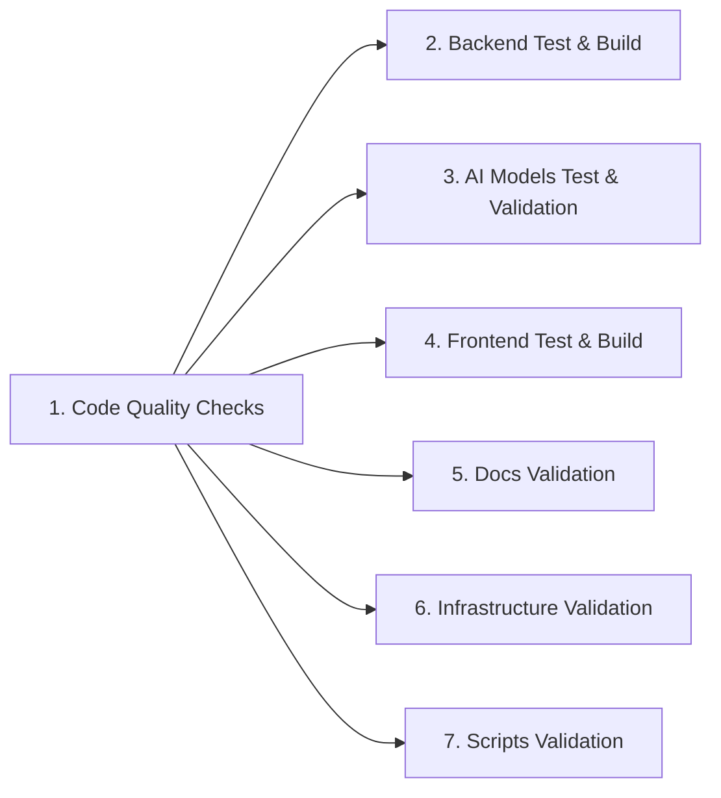

# CI/CD Pipeline

QuantumWealth uses a single GitHub Actions workflow, [`cicd.yml`](../workflows/cicd.yml), to validate every change. It contains seven jobs: one formatting gate followed by six jobs that run in parallel and cover the backend, AI modules, frontend, documentation, infrastructure, and shell scripts. See the [root README](../../README.md) for the project overview.

## Triggers

| Trigger             | Scope                          | Purpose                                         |
| :------------------ | :----------------------------- | :---------------------------------------------- |
| `push`              | `main` and `develop`           | Validate every commit that lands on a main line |
| `pull_request`      | Targeting `main` and `develop` | Block merges that fail any check                |
| `workflow_dispatch` | Any branch, run manually       | On-demand execution                             |

## Pipeline Overview



| #   | Job ID                      | Display name                | Depends on     | Timeout    | Runtime              |
| :-- | :-------------------------- | :-------------------------- | :------------- | :--------- | :------------------- |
| 1   | `code_quality`              | Code Quality Checks         | None           | Default    | Python 3.11, Node 20 |
| 2   | `backend_test_build`        | Backend Test & Build        | `code_quality` | 45 minutes | Python 3.11, Docker  |
| 3   | `ai_models_test`            | AI Models Test & Validation | `code_quality` | 45 minutes | Python 3.11          |
| 4   | `frontend_test_build`       | Frontend Test & Build       | `code_quality` | Default    | Node 20              |
| 5   | `docs_validation`           | Docs Validation             | `code_quality` | 10 minutes | Node 20, Python 3.11 |
| 6   | `infrastructure_validation` | Infrastructure Validation   | `code_quality` | 30 minutes | Python 3.11, Docker  |
| 7   | `scripts_validation`        | Scripts Validation          | `code_quality` | 10 minutes | Python 3.11          |

If Code Quality Checks fails, none of the other six jobs start, so formatting problems fail the run before any heavy dependencies are installed.

## Job 1: Code Quality Checks

| Stage                 | Control area          | Detail                                                                                               |
| :-------------------- | :-------------------- | :--------------------------------------------------------------------------------------------------- |
| Source integrity      | Checkout              | Full repository checkout with complete Git history (`fetch-depth: 0`)                                |
| Python runtime        | Standardization       | Python 3.11 with `autoflake` and `black==25.11.0` (pinned so a new release cannot change formatting) |
| Python hygiene        | Unused code           | `autoflake --remove-all-unused-imports --remove-unused-variables --recursive --check .`              |
| Python style          | Formatting            | `black . --check`, covering the backend and the AI modules                                           |
| Node runtime          | Standardization       | Node.js 20 with `prettier` and `prettier-plugin-solidity` installed globally                         |
| Repository formatting | Prettier              | Checks `js`, `jsx`, `ts`, `tsx`, `json`, `html`, `css`, `md`, `sol`, `yml`, and `yaml` files         |
| Compliance gate       | Fail on any deviation | Both checks are non-mutating, so a formatting difference fails the job instead of rewriting code     |

## Job 2: Backend Test & Build

| Stage                | Control area   | Detail                                                                                                                                                     |
| :------------------- | :------------- | :--------------------------------------------------------------------------------------------------------------------------------------------------------- |
| Environment          | Dependencies   | Python 3.11 with pip caching keyed on `code/backend/requirements.txt`; installs `pytest`, `pytest-cov`, and `pytest-asyncio` separately                    |
| Tests                | Backend suite  | `pytest tests/ --tb=short --strict-markers -v --cov=. --cov-report=xml:coverage.xml` from `code/backend`; unregistered markers fail the run                |
| Reporting            | Coverage       | Uploads `backend-coverage-report` (`coverage.xml`) on every run, even when tests fail, kept for 30 days                                                    |
| Image build          | Backend image  | Builds `code/backend/Dockerfile` as `quantumwealth-backend:ci` with `code` as the context, because the backend imports the sibling `ai_models` package     |
| Build performance    | Layer cache    | Docker Buildx with the GitHub Actions layer cache                                                                                                          |
| Container security   | Non-root check | Fails if the image runs as user id 0                                                                                                                       |
| Runtime verification | Smoke test     | Starts the image with its default Gunicorn command on port 8000 and a CI-only `SECRET_KEY`, then polls `/api/schema/` (up to 30 attempts, 2 seconds apart) |
| Runtime verification | Response check | Sends `X-Forwarded-Proto: https` to mimic a TLS proxy, because production settings redirect plain HTTP, and requires the body to be an OpenAPI document    |
| Cleanup              | Container      | Prints container logs when a step fails and always removes the container                                                                                   |

## Job 3: AI Models Test & Validation

| Stage             | Control area        | Detail                                                                                                                                                                                                                                          |
| :---------------- | :------------------ | :---------------------------------------------------------------------------------------------------------------------------------------------------------------------------------------------------------------------------------------------- |
| Environment       | Import path         | `PYTHONPATH` points at `code/`, because `ai_models` is imported as a top-level package                                                                                                                                                          |
| Dependencies      | Pinned requirements | Installs `code/ai_models/requirements.txt` plus `pytest` and `pytest-cov`, with pip caching                                                                                                                                                     |
| Static validation | Byte-compile        | `python -m compileall -q code/ai_models`, which also covers files the tests never import                                                                                                                                                        |
| Static validation | Import verification | Imports all 9 packages (`anomaly_detector`, `backtester`, `factor_models`, `market_predictor`, `portfolio_optimizer`, `risk_engine`, `robo_advisor`, `sentiment_analyzer`, `tax_optimizer`) and resolves every name in each package's `__all__` |
| Tests             | AI module suite     | `pytest tests/` from `code/ai_models` with `--cov=ai_models`, a terminal report that skips fully covered files, and an XML report                                                                                                               |
| Tests             | Network isolation   | The tests use synthetic data and patch yfinance, so the job needs no market data access                                                                                                                                                         |
| Reporting         | Coverage            | Uploads `ai-models-coverage-report` on every run (a missing file is tolerated), kept for 30 days                                                                                                                                                |

## Job 4: Frontend Test & Build

| Stage        | Control area   | Detail                                                                                                                                        |
| :----------- | :------------- | :-------------------------------------------------------------------------------------------------------------------------------------------- |
| Environment  | Node runtime   | Node.js 20 with npm caching keyed on `frontend/package-lock.json`, running in the `frontend` directory                                        |
| Dependencies | Locked install | `npm ci --legacy-peer-deps`, which installs exactly what the lock file pins and tolerates peer dependency conflicts                           |
| Linting      | ESLint         | `npm run lint`                                                                                                                                |
| Tests        | Vitest         | `npm run test:coverage` (jsdom): API client with token refresh, auth hook, shared components, layout, sign in and registration pages, routing |
| Reporting    | Coverage       | Uploads `frontend-coverage-report` (`frontend/coverage/`) on every run, kept for 30 days                                                      |
| Build        | Production     | `CI=false npm run build` (Vite)                                                                                                               |
| Reporting    | Artifact       | Uploads `frontend-dist` (`frontend/dist/`) on success, kept for 7 days                                                                        |

## Job 5: Docs Validation

| Stage             | Control area             | Detail                                                                                                                                                                                                                                                                                         |
| :---------------- | :----------------------- | :--------------------------------------------------------------------------------------------------------------------------------------------------------------------------------------------------------------------------------------------------------------------------------------------- |
| Markdown linting  | markdownlint-cli2 0.24.0 | Lints `docs/**/*.md` and the root `README.md`. Line length (MD013) is left to Prettier, bare URLs (MD034), spaces in emphasis (MD037), and fence languages (MD040) are allowed, and a short list of inline HTML elements is allowed for badges and images. Duplicate headings are still errors |
| Link integrity    | lychee 0.24.2 (offline)  | Checks internal links and heading anchors in `docs/**/*.md`, `README.md`, and `.github/readme/README.md`                                                                                                                                                                                       |
| Code samples      | Syntax validation        | Parses fenced `python` blocks with `ast`, checks `bash`, `sh`, and `shell` blocks with `bash -n`, and parses `json` blocks (`{ ... }` and `[ ... ]` placeholders are allowed) in `docs/` and the root `README.md`                                                                              |
| Docs index        | Consistency              | Every page in `docs/` must be linked from the root `README.md` as `(docs/name.md)`, since there is no separate docs index                                                                                                                                                                      |
| Script docs       | Consistency              | Every `scripts/*.sh` must be mentioned in the README or docs, and every `*.sh` file they mention must exist                                                                                                                                                                                    |
| Path references   | Consistency              | Every path written as a code span under `scripts/`, `infrastructure/`, `docs/`, `code/`, or `frontend/` must exist (`.env` files are exempt because they are git-ignored)                                                                                                                      |
| Repository weight | Size warning             | Warns (does not fail) about files in `docs/` larger than 5 MB, which currently includes the BMP hero image                                                                                                                                                                                     |
| External links    | Advisory                 | Checks external links with 2 retries and a 20 second timeout, accepting `2xx` and `429`; marked `continue-on-error`, so it never fails the job                                                                                                                                                 |

## Job 6: Infrastructure Validation

Tool versions are pinned in the job: yamllint 1.38.0 and hadolint 2.15.1.

| Stage      | Control area         | Detail                                                                                                                                                                                                 |
| :--------- | :------------------- | :----------------------------------------------------------------------------------------------------------------------------------------------------------------------------------------------------- |
| Compose    | Validation           | Copies `code/backend/.env.example` to `code/backend/.env` (every service loads it), then runs `docker compose config --quiet`                                                                          |
| Compose    | Consistency          | Build contexts, Dockerfiles, `env_file` entries, and bind-mount sources must exist; named volumes must be declared; `depends_on` must reference real services                                          |
| Compose    | Database settings    | In `.env.example`, `DB_NAME`, `DB_USER`, and `DB_PASSWORD` must equal `POSTGRES_DB`, `POSTGRES_USER`, and `POSTGRES_PASSWORD`, and `init.sql` must grant on that database and manage that role         |
| YAML       | yamllint             | Lints `docker-compose.yml` with the `relaxed` ruleset, line length and truthy checks disabled                                                                                                          |
| Nginx      | Syntax test          | Runs `nginx -t` in the same image tag Compose uses, mounting `infrastructure/nginx/nginx.conf` and pointing the `backend` upstream at localhost                                                        |
| PostgreSQL | Init script          | Starts the Compose Postgres image with `init.sql` mounted as the entrypoint script, waits up to 45 attempts (2 seconds apart) for the server to be ready, and fails if the container exits early       |
| PostgreSQL | Idempotency          | Re-applies `init.sql` by hand with `ON_ERROR_STOP`, because the script must be safe to run twice                                                                                                       |
| PostgreSQL | Extensions           | Requires `uuid-ossp`, `pg_trgm`, and `btree_gin` to be installed; the container is always removed afterwards                                                                                           |
| Docker     | Dockerfile linting   | `hadolint --failure-threshold error` on `code/backend/Dockerfile` and `frontend/Dockerfile`                                                                                                            |
| Docker     | Frontend image build | Builds the standalone `frontend/Dockerfile` (not pushed) with a GitHub Actions layer cache; Compose builds the frontend into a shared volume instead, so nothing else would catch this image breaking  |
| Secrets    | Hard-coded secrets   | Scans `infrastructure/` and `docker-compose.yml` for password, secret, API key, and private key patterns, ignoring `.example` files, placeholders, comments, and the documented local default password |

## Job 7: Scripts Validation

| Stage        | Control area       | Detail                                                                                                                                                    |
| :----------- | :----------------- | :-------------------------------------------------------------------------------------------------------------------------------------------------------- |
| Static check | ShellCheck         | `shellcheck --severity=warning` on every tracked `*.sh` file; warnings and errors fail the job (`shellcheck-py==0.11.0.1`)                                |
| Static check | Stricter findings  | Advisory: `shellcheck --severity=info`, marked `continue-on-error`                                                                                        |
| Syntax       | `bash -n`          | Parses every tracked shell script and requires a `bash` or `sh` shebang on the first line                                                                 |
| Repository   | Executable bit     | Every tracked `*.sh` file must be mode `100755` in Git; the error message shows the `git update-index --chmod=+x` fix                                     |
| Consistency  | Required files     | The scripts rely on `manage.py`, both `requirements.txt` files, `.env.example`, and `docker-compose.yml`, which must all exist                            |
| Consistency  | Settings module    | The Django settings module named in `scripts/setup.sh` must exist under `code/backend`                                                                    |
| Consistency  | Backup script      | The Compose service that `scripts/backup_db.sh` runs `pg_dump` in must exist, and its default `DB_USER` and `DB_NAME` must match `.env.example`           |
| Scope note   | No `--help` checks | Neither script has a `--help` handler (setup creates a virtualenv and installs packages, backup needs a running database), so there is no safe smoke test |

## Artifacts

| Artifact                    | Produced by                 | Contents                      | Retention |
| :-------------------------- | :-------------------------- | :---------------------------- | :-------- |
| `backend-coverage-report`   | Backend Test & Build        | `code/backend/coverage.xml`   | 30 days   |
| `ai-models-coverage-report` | AI Models Test & Validation | `code/ai_models/coverage.xml` | 30 days   |
| `frontend-coverage-report`  | Frontend Test & Build       | `frontend/coverage/`          | 30 days   |
| `frontend-dist`             | Frontend Test & Build       | `frontend/dist/`              | 7 days    |

## Advisory Steps

These steps report problems without failing the pipeline (`continue-on-error: true`):

| Job                | Step                               |
| :----------------- | :--------------------------------- |
| Docs Validation    | External link check                |
| Scripts Validation | ShellCheck stricter style findings |

## Reproducing the Checks Locally

```bash
# Job 1: formatting (from the repository root)
pip install autoflake black==25.11.0
autoflake --remove-all-unused-imports --remove-unused-variables --recursive --check .
black . --check
npm install -g prettier prettier-plugin-solidity
prettier --plugin="$(npm root -g)/prettier-plugin-solidity/dist/index.js" \
  --check "**/*.{js,jsx,ts,tsx,json,html,css,md,sol,yml,yaml}"

# Job 2: backend tests (from code/backend)
pytest tests/ --tb=short --strict-markers --cov=.

# Job 3: AI module tests (from code/ai_models)
PYTHONPATH=.. pytest tests/ --cov=ai_models

# Job 4: frontend (from frontend)
npm ci --legacy-peer-deps && npm run lint && npm run test:coverage && npm run build

# Job 6: Compose and Nginx checks (from the repository root)
cp code/backend/.env.example code/backend/.env
docker compose config --quiet

# Job 7: shell scripts (from the repository root)
git ls-files -z '*.sh' | xargs -0 shellcheck --severity=warning
```
