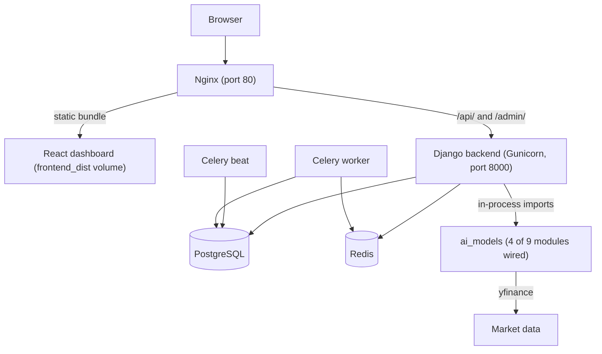

# QuantumWealth

[](https://github.com/quantsingularity/QuantumWealth/actions/workflows/cicd.yml)
[](LICENSE)


QuantumWealth is an AI-powered wealth management and robo-advisory platform. A Django REST backend covers accounts, advisor, market, portfolio, risk, and tax; a React dashboard sits in front of it; and nine pure-Python AI modules (portfolio optimization, risk, robo-advice, market prediction, tax optimization, sentiment, factor models, backtesting, and anomaly detection) are imported directly by the backend with no network boundary.

<div align="center">
  
</div>

## Table of Contents

- [Overview](#overview)
- [Architecture](#architecture)
- [Project Structure](#project-structure)
- [Feature Status](#feature-status)
- [Technology Stack](#technology-stack)
- [Installation and Setup](#installation-and-setup)
- [Running the Stack](#running-the-stack)
- [API Surface](#api-surface)
- [Testing](#testing)
- [CI/CD Pipeline](#cicd-pipeline)
- [Documentation](#documentation)
- [Contributing](#contributing)
- [License](#license)

## Overview

| Topic              | Summary                                                                                                                                                     |
| :----------------- | :---------------------------------------------------------------------------------------------------------------------------------------------------------- |
| Deployment model   | One Django backend (Gunicorn), a Celery worker and beat scheduler, PostgreSQL, Redis, and Nginx, all defined in a single Compose file.                      |
| AI modules         | Nine modules in `code/ai_models`, imported in-process by Django service classes. Market data comes from yfinance.                                           |
| Backend wiring     | Four modules are called by the backend: portfolio optimizer, risk engine, robo advisor, and market predictor.                                               |
| Standalone modules | Tax optimizer, sentiment analyzer, factor models, backtester, and anomaly detector are implemented and tested, but are not yet imported by any backend app. |
| Tests              | 192 backend tests, 154 AI module tests, and 126 frontend tests. All three suites run in CI.                                                                 |

## Architecture



| Compose service  | Image or build            | Host port | Role                                                                 |
| :--------------- | :------------------------ | :-------- | :------------------------------------------------------------------- |
| `nginx`          | `nginx:1.25-alpine`       | 80        | Serves the React bundle, static and media files, and proxies the API |
| `backend`        | `code/backend/Dockerfile` | None      | Runs migrations and `collectstatic`, then Gunicorn with 4 workers    |
| `celery_worker`  | `code/backend/Dockerfile` | None      | Background tasks (concurrency 4)                                     |
| `celery_beat`    | `code/backend/Dockerfile` | None      | Scheduled tasks via the django-celery-beat database scheduler        |
| `db`             | `postgres:16-alpine`      | 5433      | PostgreSQL, initialized by `infrastructure/postgres/init.sql`        |
| `redis`          | `redis:7-alpine`          | 6379      | Cache and Celery broker (256 MB, LRU eviction)                       |
| `frontend-build` | `node:20-alpine`          | None      | One-shot job that builds the dashboard into a shared volume          |

See [docs/architecture.md](docs/architecture.md) for detail.

## Project Structure

| Path                 | Purpose                                                                                        |
| :------------------- | :--------------------------------------------------------------------------------------------- |
| `code/backend`       | Django backend: config, the six apps, tests, Dockerfile, and a Makefile of developer shortcuts |
| `code/ai_models`     | The nine AI modules and their tests (see [Feature Status](#feature-status))                    |
| `frontend`           | React (Vite) web dashboard, with its own Dockerfile and tests                                  |
| `infrastructure`     | Nginx configuration and the PostgreSQL init script                                             |
| `scripts`            | `setup.sh` (local setup) and `backup_db.sh` (database backup)                                  |
| `docs`               | Project documentation                                                                          |
| `docker-compose.yml` | Full stack definition                                                                          |
| `.github`            | CI/CD workflow and its documentation                                                           |

## Feature Status

| Component                  | Backend wiring | Details                                                                                                                                                         |
| :------------------------- | :------------- | :-------------------------------------------------------------------------------------------------------------------------------------------------------------- |
| **API**                    | Not applicable | Django REST backend with accounts, advisor, market, portfolio, risk, and tax apps. Swagger UI and ReDoc are served alongside the API.                           |
| **Portfolio optimization** | Wired          | cvxpy-based mean-variance, Black-Litterman, risk parity, and Hierarchical Risk Parity, with market data from yfinance.                                          |
| **Risk engine**            | Wired          | Historical VaR, parametric VaR, CVaR, Monte Carlo GBM simulation, and 5 stress scenarios (2008 crisis, COVID crash, dot-com bust, rate shock, inflation spike). |
| **Robo advisor**           | Wired          | Future-value and payment-based goal planning, Equal Risk Contribution rebalancing, and concentration detection.                                                 |
| **Market predictor**       | Wired          | GBM price forecasting (a stand-in for a trained LSTM, which is not included), rolling regime detection, and RSI plus SMA indicators.                            |
| **Tax optimizer**          | Standalone     | Greedy tax-loss harvest scheduling, an after-tax return model, and a wash-sale calendar. The tax app has its own services and does not import this module.      |
| **Sentiment analyzer**     | Standalone     | VADER-based news sentiment combined with momentum, volume, and RSI into a composite signal. Falls back to a neutral score if VADER is not installed.            |
| **Factor models**          | Standalone     | Fama-French 5-factor OLS regression, Brinson-Hood-Beebower attribution, and sector decomposition.                                                               |
| **Backtester**             | Standalone     | Event-driven simulation with transaction costs and benchmark comparison.                                                                                        |
| **Anomaly detector**       | Standalone     | Isolation Forest, z-score outlier detection, and wash-sale clustering.                                                                                          |
| **Background tasks**       | Not applicable | Celery worker and beat containers for background and scheduled work, with Redis as the broker.                                                                  |
| **Web dashboard**          | Not applicable | React 18 app (Vite, plain JavaScript) with Tailwind CSS, React Router, and Recharts.                                                                            |

## Technology Stack

| Area                 | Technology                                                                                                             |
| :------------------- | :--------------------------------------------------------------------------------------------------------------------- |
| Backend              | Python 3.12 (backend image; CI tests on 3.11), Django 5.x, Django REST Framework, SimpleJWT, drf-spectacular, Gunicorn |
| Data layer           | PostgreSQL 16, Redis 7 (cache and Celery broker)                                                                       |
| Background tasks     | Celery (worker and beat, both containerized), django-celery-beat                                                       |
| Quant / optimization | cvxpy (Black-Litterman, HRP, mean-variance, risk parity), SciPy, NumPy, pandas                                         |
| Market data          | yfinance                                                                                                               |
| Sentiment            | VADER (vaderSentiment), with a neutral-score fallback if not installed                                                 |
| Anomaly detection    | scikit-learn (Isolation Forest)                                                                                        |
| Web frontend         | React 18, Vite 5, Tailwind CSS 3, React Router 6, Recharts                                                             |
| Infrastructure       | Docker, Docker Compose, Nginx                                                                                          |
| CI/CD                | GitHub Actions                                                                                                         |
| Testing              | pytest (backend and AI modules), Vitest and Testing Library (frontend)                                                 |

## Installation and Setup

Prerequisites: Python 3.12+ (the backend image uses 3.12 and `scripts/setup.sh` requires it; CI also tests on 3.11), Node.js 20+, and Docker. The local backend also needs a PostgreSQL instance with the role and database named in `.env`.

Docker:

```bash
git clone https://github.com/quantsingularity/QuantumWealth.git
cd QuantumWealth
cp code/backend/.env.example code/backend/.env
# edit .env: set SECRET_KEY and DB_PASSWORD
# POSTGRES_PASSWORD must have the same value as DB_PASSWORD

docker compose up --build -d
docker compose exec backend python manage.py seed_demo_data
```

Local backend:

```bash
cd code/backend
python -m venv .venv && source .venv/bin/activate
pip install -r requirements.txt
pip install -r ../ai_models/requirements.txt
cp .env.example .env
python manage.py migrate
python manage.py seed_demo_data
python manage.py runserver
```

Local frontend:

```bash
cd frontend
npm ci --legacy-peer-deps
npm run dev
```

`scripts/setup.sh` automates the local backend setup (virtualenv, dependencies, `.env`, and migrations). See [docs/deployment.md](docs/deployment.md) for local, Docker, and production instructions.

## Running the Stack

```bash
docker compose up --build -d
```

| Service      | URL                           |
| :----------- | :---------------------------- |
| Dashboard    | `http://localhost/`           |
| Swagger UI   | `http://localhost/api/docs/`  |
| ReDoc        | `http://localhost/api/redoc/` |
| Django Admin | `http://localhost/admin/`     |

Demo login (local development only): `demo@quantumwealth.ai` / `Demo1234!`

Database backups use `scripts/backup_db.sh`, which runs `pg_dump` inside the running Compose database service.

## API Surface

All application endpoints live under `/api/v1/`. Full request and response schemas are in [docs/api-reference.md](docs/api-reference.md), and interactively at `/api/docs/` (Swagger) or `/api/redoc/` once the API is running.

| Area             | Base path            | Endpoints                                                                                                                                                                                            |
| :--------------- | :------------------- | :--------------------------------------------------------------------------------------------------------------------------------------------------------------------------------------------------- |
| Accounts         | `/api/v1/auth/`      | `register/`, `login/`, `logout/`, `token/refresh/`, `me/`, `change-password/`, `password-reset/` (and `confirm/`), `verify-email/{token}/`, `risk-questionnaire/`, `notifications/`, `price-alerts/` |
| Portfolio        | `/api/v1/portfolio/` | Portfolio CRUD, plus `{id}/holdings/`, `{id}/transactions/`, `{id}/optimize/`, `{id}/performance/`, `{id}/history/`, `{id}/snapshot/`, and `goals/` with `goals/{id}/plan/`                          |
| Market           | `/api/v1/market/`    | `quote/{ticker}/`, `quotes/bulk/`, `history/{ticker}/`, `predict/{ticker}/`, `search/`, `sectors/`, `watchlists/`                                                                                    |
| Risk             | `/api/v1/risk/`      | `report/{portfolio_id}/`, `var/{portfolio_id}/`, `stress-test/{portfolio_id}/`, `monte-carlo/{portfolio_id}/`, `correlation/{portfolio_id}/`                                                         |
| Advisor          | `/api/v1/advisor/`   | `plan/`, `rebalance/{portfolio_id}/`, `recommendations/{portfolio_id}/`, `drift/{portfolio_id}/`, `suggested-allocation/`                                                                            |
| Tax              | `/api/v1/tax/`       | `harvest/{portfolio_id}/`, `gain-loss/{portfolio_id}/`, `asset-location/{portfolio_id}/`, `wash-sale-check/{portfolio_id}/`                                                                          |
| Schema and admin | Site root            | `/api/schema/`, `/api/docs/`, `/api/redoc/`, `/admin/`                                                                                                                                               |

## Testing

| Suite     | Directory        | Tests | Run locally                   |
| :-------- | :--------------- | :---- | :---------------------------- |
| Backend   | `code/backend`   | 192   | `pytest`                      |
| AI models | `code/ai_models` | 154   | `PYTHONPATH=.. pytest tests/` |
| Frontend  | `frontend`       | 126   | `npm test`                    |

Run each command from the directory shown. All three suites run in CI, and the AI module tests use synthetic data and patch yfinance, so they need no network. `code/backend/Makefile` also provides `make test` and `make test-coverage`.

See [docs/testing.md](docs/testing.md) for what each suite covers.

## CI/CD Pipeline

GitHub Actions (`.github/workflows/cicd.yml`) runs on pushes and pull requests to `main` and `develop`, and on manual dispatch. Every job after the first depends on **Code Quality Checks**, so the other six run in parallel once formatting passes.

| #   | Job                         | Depends on          | What it does                                                                                                                                                                                   |
| :-- | :-------------------------- | :------------------ | :--------------------------------------------------------------------------------------------------------------------------------------------------------------------------------------------- |
| 1   | Code Quality Checks         | None                | `autoflake` and `black --check` on Python, plus a repository-wide Prettier check (JS, TS, JSON, HTML, CSS, Markdown, Solidity, YAML)                                                           |
| 2   | Backend Test & Build        | Code Quality Checks | Runs pytest with coverage, builds the backend image, checks it runs as non-root, and smoke tests the container by fetching the OpenAPI schema                                                  |
| 3   | AI Models Test & Validation | Code Quality Checks | Byte-compiles the AI modules, verifies all 9 packages and their exports import cleanly, and runs their pytest suite with coverage                                                              |
| 4   | Frontend Test & Build       | Code Quality Checks | `npm ci`, ESLint, the Vitest suite with coverage, then the production Vite build and bundle upload                                                                                             |
| 5   | Docs Validation             | Code Quality Checks | markdownlint, offline link and anchor checks, syntax checks for Python, Bash, and JSON code blocks, docs and repository consistency checks, and an advisory external link check                |
| 6   | Infrastructure Validation   | Code Quality Checks | Docker Compose validation and consistency checks, yamllint, `nginx -t`, a PostgreSQL init script run (including a second, idempotent run), hadolint, a frontend image build, and a secret scan |
| 7   | Scripts Validation          | Code Quality Checks | ShellCheck, syntax, shebang, and executable-bit checks, plus a check that the scripts agree with the Compose file and `.env.example`                                                           |

Coverage reports are kept for 30 days and the frontend bundle for 7 days. The step-by-step breakdown of each job is in [.github/readme/README.md](.github/readme/README.md).

## Documentation

| Document                                           | Contents                                                      |
| :------------------------------------------------- | :------------------------------------------------------------ |
| [docs/overview.md](docs/overview.md)               | Platform goals, architecture, technology stack                |
| [docs/api-reference.md](docs/api-reference.md)     | Complete endpoint reference with request and response schemas |
| [docs/ai-models.md](docs/ai-models.md)             | Mathematical foundations for all AI and ML modules            |
| [docs/database-schema.md](docs/database-schema.md) | Full table definitions with column types and indexes          |
| [docs/architecture.md](docs/architecture.md)       | System design, request lifecycle, security model, scalability |
| [docs/developer-guide.md](docs/developer-guide.md) | Contributing guide, code style, testing patterns              |
| [docs/deployment.md](docs/deployment.md)           | Local, Docker, and production deployment instructions         |
| [docs/testing.md](docs/testing.md)                 | Test suite overview and instructions                          |

## Contributing

See [docs/developer-guide.md](docs/developer-guide.md) for the contributing guide, code style, and testing patterns. Open a pull request; every CI job must pass before merging.

## License

This project is licensed under the MIT License. See the [LICENSE](LICENSE) file for details.
